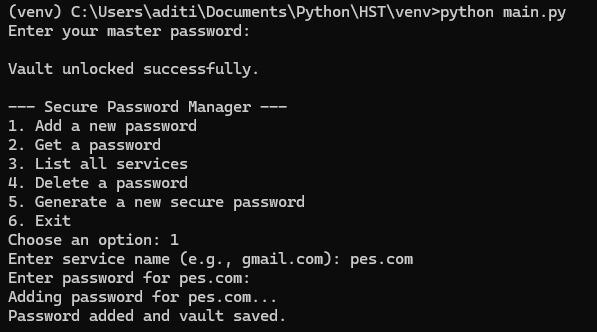
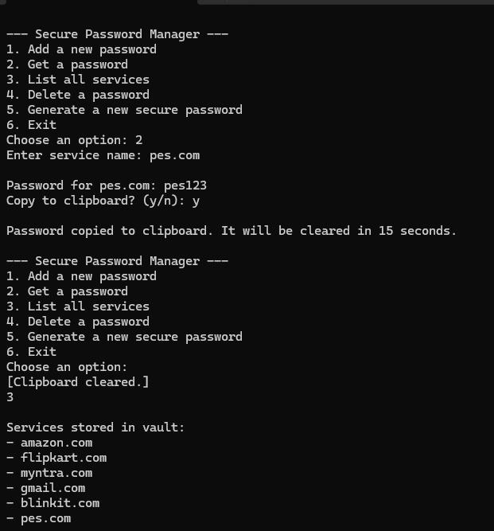
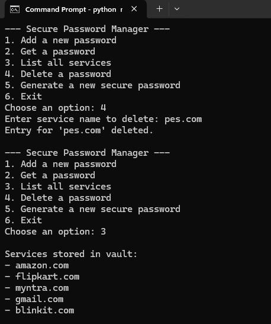
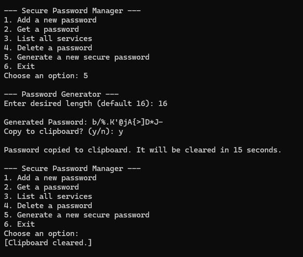
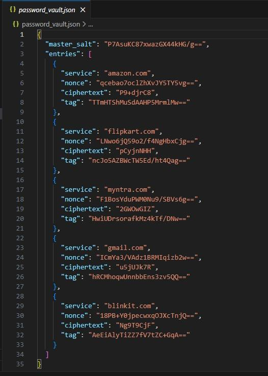
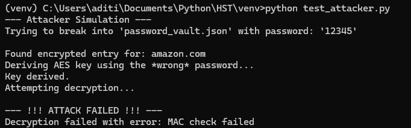

# Python "Defense-in-Depth" Password Vault

A command-line password manager that stores credentials in an encrypted JSON vault. It establishes the security model in software; the [AES-128 FPGA engine](../vivado-fpga/) is the step towards moving the cryptography into dedicated hardware.

**Authors:** Aditi Chandra and Akanksha Venkatesh

## Design

The code is split into a cryptographic "kernel" and an application layer, so that all key handling lives in one small, isolated module.

| File | Role |
|---|---|
| `crypto_engine.py` | The kernel. Derives the key (PBKDF2), encrypts and decrypts with AES-256-GCM. Knows nothing about files or the UI. |
| `vault.py` | Loads and saves `password_vault.json` (salt and entries Base64-encoded), adds, finds and deletes entries. |
| `main.py` | Menu, user input, secure clipboard and password generator. |
| `test_attacker.py` | Simulates an attacker who has stolen the vault file and tries a wrong master password. |

### Key derivation: PBKDF2-HMAC-SHA256

- A random 16-byte salt is generated when the vault is created and stored with it, so identical master passwords give different keys.
- 600,000 iterations make every password guess deliberately slow, which defends against offline GPU brute force on a stolen vault file.
- The output is a 32-byte (256-bit) AES key, held in memory only for the session.

### Authenticated encryption: AES-256-GCM

- Each entry gets a fresh random nonce.
- The service name is passed as associated data, so an attacker cannot swap ciphertexts between services.
- GCM produces an authentication tag. `decrypt_and_verify` refuses to return any plaintext if the key is wrong or a single bit of the stored data has been changed.
- On opening, the vault decrypts its first entry as a check that the master password is correct.

### Other protections

- **Secure clipboard:** after a password is copied, a background timer overwrites the clipboard with an empty string, shrinking the window for clipboard-snooping malware.
- **Password generator:** uses the `secrets` module, which draws from the operating system's CSPRNG, rather than the predictable `random` module.
- The master password and stored passwords are typed with `getpass`, so they are not echoed to the screen.

## Running it

```bash
pip install -r requirements.txt
python main.py
```

On the first run, the master password you enter creates a new `password_vault.json`. Later runs unlock it with the same password.

Menu options: 1 add, 2 get (with optional copy to clipboard), 3 list services, 4 delete, 5 generate a password, 6 exit.

To run the attack simulation (add at least one entry first):

```bash
python test_attacker.py
```

## Results

**1. Creating the vault and adding a password**



**2. Retrieving a password, secure clipboard and listing services**

The clipboard is cleared automatically after the timer expires.



**3. Deleting an entry**

The entry is removed and the whole vault file is rewritten.



**4. Generating a strong password**



**5. The vault file on disk**

Only service names are readable; every password is stored as nonce, ciphertext and tag, all Base64-encoded, alongside the master salt.



**6. Attacker simulation**

With the wrong password, PBKDF2 still produces *a* key, but it is the wrong one, so the GCM tag check fails and no plaintext is released.



## Notes

- The clipboard timer is started with a 1-second delay and the clear function then sleeps for 15 seconds, so the clipboard is actually cleared about 16 seconds after copying.
- `password_vault.json` is excluded from the repository by `.gitignore`.
- The weakness that motivates the hardware engine: the derived key lives in the host's RAM, where malware running on the same machine could reach it.
